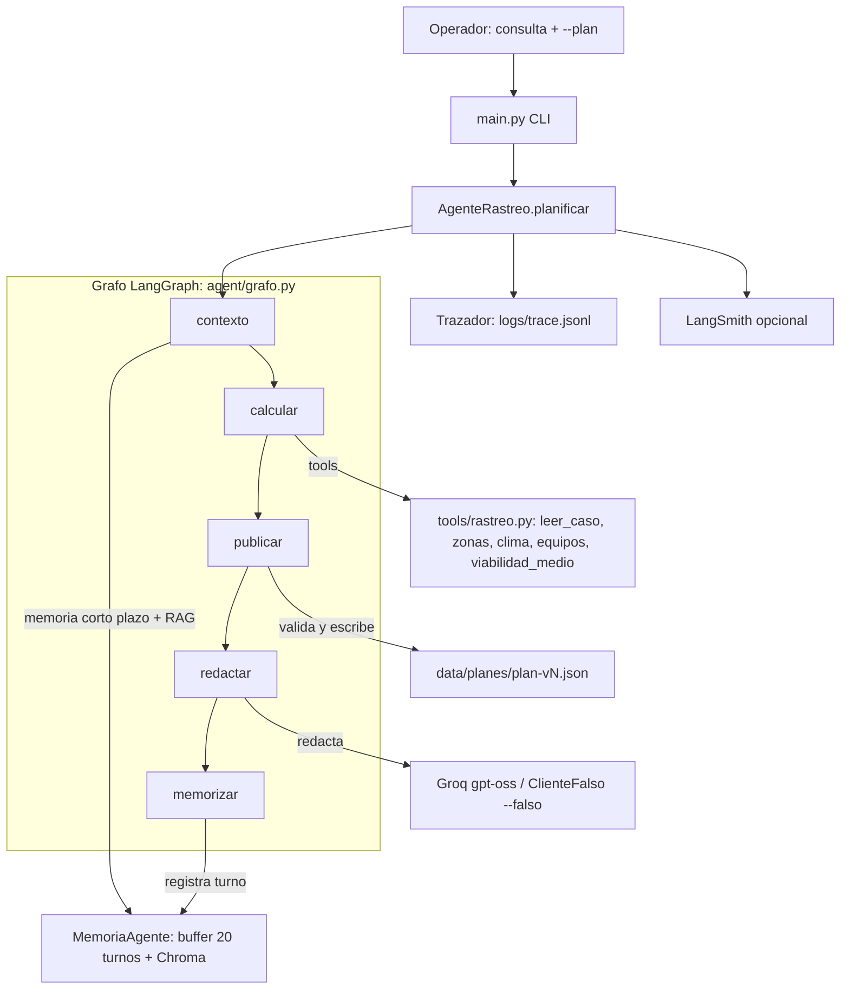

# ep2-rescate-agente — EP2 ISY0101

Agente conversacional con tools que convierte el reporte de una persona
desaparecida en un **plan de búsqueda por fases** y lo **replanifica en vivo**
cuando el clima invalida la ventana de un medio (el viento cierra el
helicóptero, el dron solo vuela donde el pronóstico lo permite).

**Disclaimer:** simulación con fines académicos; personas, protocolo y
pronóstico ficticios. No apto para operaciones reales.

## Cómo correr

```bash
uv sync
uv run python -m ingestion.ingest          # corpus -> Chroma (2/2 MATCH)
uv run python -m pytest -q                 # 11 passed (motor 6 + dominio 5)

# Acto 1 — clima bueno (reporte -> plan v1)
uv run python main.py "excursionista desaparecida en El Morado; ultimo contacto 14:05 en el mirador" --plan --falso --sesion caso-morado --pasos

# Acto 2 — el operador reemplaza las franjas 06:00-12:00 de data/clima.json por
# la tabla de viento del brief (§6, 38-55 km/h) y replanifica:
uv run python main.py "replanifica el operativo por el viento" --plan --falso --sesion caso-morado --pasos
cat data/planes/plan-v2.json
```

El CLI publica la siguiente versión libre (`plan-v<N>.json`). Para reproducir
los actos desde cero: borra `data/planes/plan-*.json` (el repo conserva
`plan-v1.json` como evidencia).

Evidencia de corridas reales: `docs/salida-acto1.txt`, `docs/salida-acto2.txt`.
Informe: `docs/informe-ep2.pdf` (4 págs) y `docs/informe-ep2.docx`.

## Arquitectura



**Justificación de componentes:**

- **Orquestación LangGraph.** `agent/grafo.py` declara `EstadoPlan` y compila
  cinco nodos (`contexto → calcular → publicar → redactar → memorizar`);
  `planificar()` invoca el grafo. Se prefirió a CrewAI porque el problema es un
  pipeline con estado explícito y control determinista, no una conversación
  entre roles.
- **Código determinista decide, LLM redacta.** La prioridad de zonas (fórmula
  `probabilidad × facilidad / tiempo` del corpus), las fases y la viabilidad de
  cada medio se calculan en Python aplicando el protocolo; el LLM solo redacta
  el parte narrativo. Por eso el agente es demostrable sin red (`--falso`) y
  reproducible.
- **Memoria de corto plazo:** buffer JSON de 20 turnos + colección Chroma
  `memoria`; en la replanificación el parte cita el plan v1 previo de la sesión
  (`memoria:caso-morado`).
- **RAG:** colección Chroma `conocimiento` con protocolo y criterios; cada
  decisión cita `[F#]` (fragmentos de corpus) y `[T#]` (hechos de tools).
- **Tools de lectura** (`leer_caso`, `detalle_zonas`, `pronostico`,
  `equipos_disponibles`, `viabilidad_medio`) y **de escritura**
  (`publicar_plan`: valida franja ISO, zonas y medios contra los JSON antes de
  escribir `data/planes/plan-v<N>.json`).
- **Guardrail central:** ningún medio se asigna fuera de su ventana (viento,
  visibilidad, luz, autonomía); no se ingresa a zonas técnicas de noche.

## Qué demuestra (actos)

- **Acto 1:** convierte el reporte en un plan por fases firmado con las reglas
  del protocolo: Z-2 (último contacto) primero, fase nocturna sin zonas
  técnicas, helicóptero y dron dentro de ventana.
- **Acto 2:** el viento sube a 38-55 km/h → HEL-1 fuera de 06:00-12:00 con
  motivo explícito citando la regla (§3) y el replanificado obligatorio (§4);
  DR-1 solo donde vuela (Z-5); barrido terrestre reforzado; propone reevaluar
  el helicóptero en la tarde según pronóstico; y el parte cita el plan v1
  previo vía memoria.

## Estado

- Tests: 11/11 (`uv run python -m pytest -q`).
- LangGraph: 5 nodos en `agent/grafo.py`; el test del grafo cubre el flujo completo.
- Actos 1 y 2 verificados end-to-end con `--falso` (2026-10-19); evidencia en `docs/`.
- Informe EP2: `docs/informe-ep2.pdf` (4 págs) y `docs/informe-ep2.docx`.
- Opcional: evidencia con Groq real (`.env` + `ClienteLangChain`) y evals del parte narrativo.
