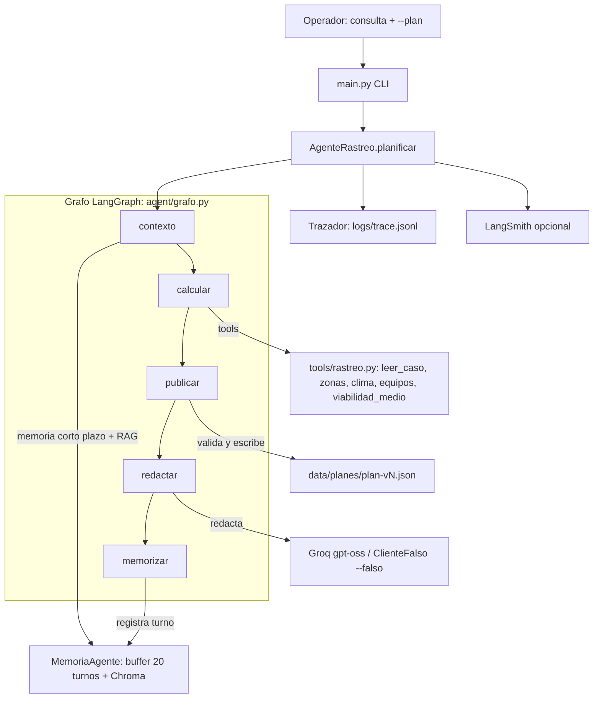

# ep2-rescate-agente — EP2 ISY0101

Agente con tools que convierte el reporte de una persona
desaparecida en un **plan de búsqueda por fases** y lo **replanifica en vivo**
cuando el clima invalida la ventana de un medio (el viento cierra el
helicóptero, el dron solo vuela donde el pronóstico lo permite).

**Disclaimer:** simulación con fines académicos; personas, protocolo y
pronóstico ficticios. No apto para operaciones reales.

## Cómo correr

```powershell
uv sync
uv run python -m ingestion.ingest          # corpus -> Chroma (2/2 MATCH)
uv run python -m pytest -q                 # 19 passed (motor 8 + dominio 6 + consulta 5)

# Deja el estado limpio: borra planes/trazas/memoria y restaura clima-base.json
uv run python scripts/reset_demo.py

# Acto 1 — clima bueno (reporte -> plan v1). Sin --falso usa Groq real.
uv run python main.py "excursionista desaparecida en El Morado; ultimo contacto 14:05 en el mirador" --plan --sesion caso-morado --pasos

# Acto 2 — aplica el evento de viento del brief (38-55 km/h) y replanifica:
uv run python scripts/aplicar_viento.py
uv run python main.py "replanifica el operativo por el viento" --plan --sesion caso-morado --pasos
Get-Content data/planes/plan-v2.json
```

`main.py` usa `ClienteLangChain` (Groq `openai/gpt-oss-120b`) por defecto;
`--falso` activa el cliente determinista para trabajar sin red o sin cuota.
El CLI publica la siguiente versión libre (`plan-v<N>.json`). Para repetir los
actos desde cero, ejecuta `reset_demo.py` antes del acto 1; el reset también
restaura `data/clima.json` desde `data/clima-base.json`. `data/planes/plan-v1.json`
se conserva versionado como evidencia del acto 1.

Evidencia: `docs/salida-acto1.txt`, `docs/salida-acto2.txt` y
`docs/plan-v2-evidencia.json` (plan v2 generado por el acto 2).
Informe: `docs/informe-ep2.pdf` (4 págs) y `docs/informe-ep2.docx`.

## Interfaz Streamlit (demo EP2)

```powershell
uv run streamlit run app.py --server.port 8501 --server.address 127.0.0.1
```

Abre `http://127.0.0.1:8501`. La interfaz usa **Groq real por defecto**. El
toggle `Determinista` activa `ClienteFalso` y muestra el sello
`DETERMINISTA · SIN GROQ`; no lo presentes como una corrida real.

Secuencia de demo: **Reiniciar escenario → Publicar plan inicial → Aplicar
viento → Replanificar**. La UI reutiliza `scripts/reset_demo.py`,
`scripts/aplicar_viento.py` y `AgenteRastreo.planificar`; no duplica la lógica
del agente ni cambia el plan calculado. Si falla la red o la cuota, usa el CLI
con `--falso` como plan B y dilo explícitamente.

El botón **Consultar** responde dudas dentro del dominio con RAG, clima,
equipos y el plan publicado (`plan-publicado`); no publica ni versiona un plan.
Si la consulta está fuera del operativo (por ejemplo, "¿cuál es la capital de
Francia?"), responde con un rechazo explícito y ejemplos, sin gastar LLM ni
crear archivos. Es la misma puerta de dominio que usa `planificar`.

## Arquitectura



**Justificación de componentes:**

- **Orquestación LangGraph.** `agent/grafo.py` declara `EstadoPlan` y compila
  cinco nodos (`contexto → calcular → publicar → redactar → memorizar`);
  `planificar()` invoca el grafo. Se prefirió a CrewAI porque el problema es un
  pipeline con estado explícito y control determinista, no una conversación
  entre roles.
- **Código determinista decide, LLM redacta.** La prioridad de zonas (fórmula
  `probabilidad × facilidad / tiempo` del corpus), las fases y la viabilidad de
  cada medio se calculan en Python aplicando el protocolo; el LLM solo redacta
  el parte narrativo. Por eso el agente es demostrable sin red (`--falso`) y
  reproducible.
- **Memoria:** buffer JSON de 20 turnos + colección Chroma `memoria`. El nodo
  `contexto` recupera el plan v1 del buffer y hace `memoria.recuperar` por
  sesión; en el acto 2 las fuentes incluyen `memoria-semantica:caso-morado` y
  `memoria:caso-morado`.
- **RAG:** colección Chroma `conocimiento` con protocolo y criterios; el parte
  narrativo cita `[F#]` (fragmentos de corpus) y `[T#]` (hechos de tools); el
  JSON del plan guarda citas legibles para auditoría.
- **Tools de lectura** (`leer_caso`, `detalle_zonas`, `pronostico`,
  `equipos_disponibles`, `viabilidad_medio`) y **de escritura**
  (`publicar_plan`: valida versión, fases, franja ISO, zonas y medios contra los
  JSON antes de escribir `data/planes/plan-v<N>.json`; no calcula viabilidad).
- **Guardrail central:** la viabilidad de un medio aéreo se calcula antes con
  `viabilidad_medio` (viento, visibilidad y luz) y las fases nocturnas no
  incluyen zonas técnicas. El LLM recibe el plan ya publicado y no puede
  modificarlo.

## Qué demuestra (actos)

- **Acto 1:** convierte el reporte en un plan por fases firmado con las reglas
  del protocolo: Z-2 (último contacto) primero, fase nocturna sin zonas
  técnicas, helicóptero y dron dentro de ventana.
- **Acto 2:** el viento sube a 38-55 km/h → HEL-1 fuera de 06:00-12:00 con
  motivo explícito citando la regla (§3) y el replanificado obligatorio (§4);
  DR-1 solo donde vuela (Z-5); barrido terrestre reforzado; propone reevaluar
  el helicóptero en la tarde según pronóstico; y el parte cita el plan v1
  previo vía memoria.

## Estado

- Tests: 19/19 (`uv run python -m pytest -q`); incluye recuperación semántica en `contexto`, citas con espacios y la puerta de dominio del modo consulta.
- LangGraph: 5 nodos en `agent/grafo.py`; el test del grafo cubre el flujo completo.
- Actos 1 y 2 verificados end-to-end el 2026-10-19 con Groq real
  (`openai/gpt-oss-120b`); evidencia en `docs/`.
- Informe EP2: `docs/informe-ep2.pdf` (4 págs) y `docs/informe-ep2.docx`.
- `--falso` reproduce el mismo plan sin red ni cuota.
